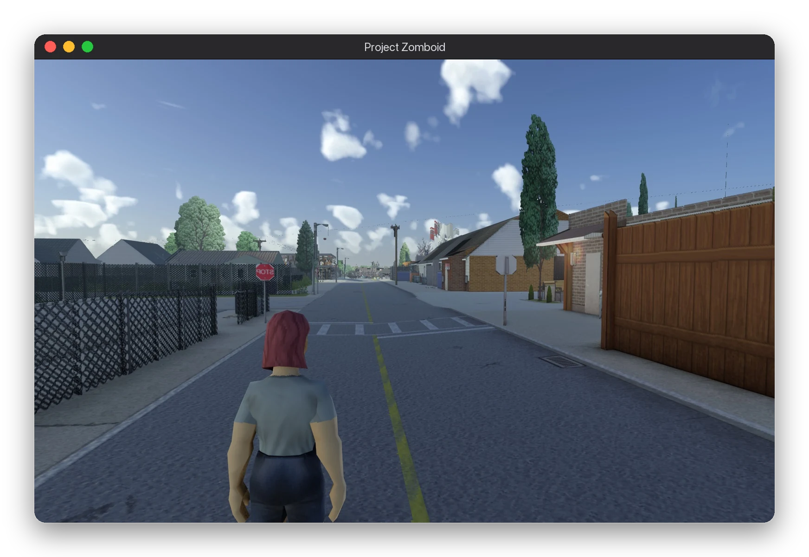
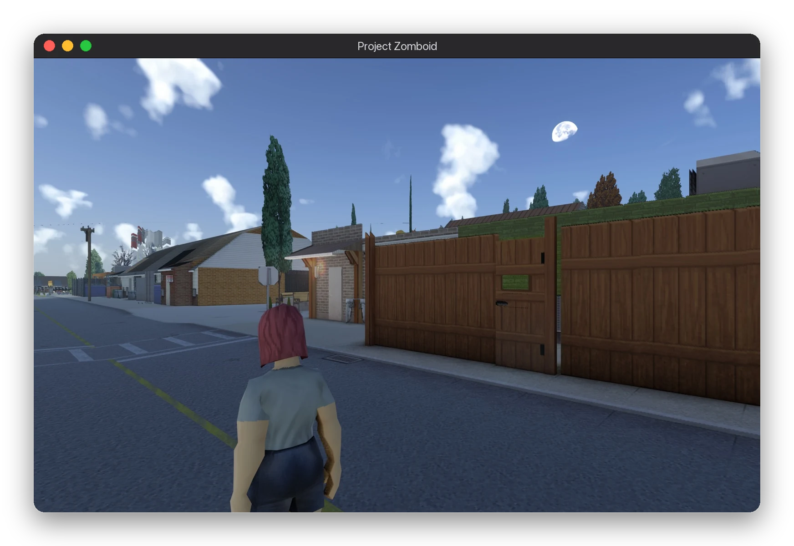
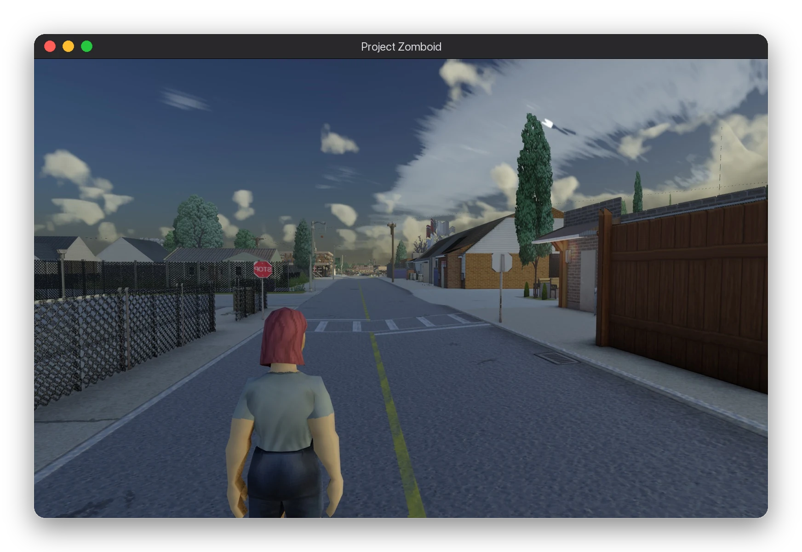
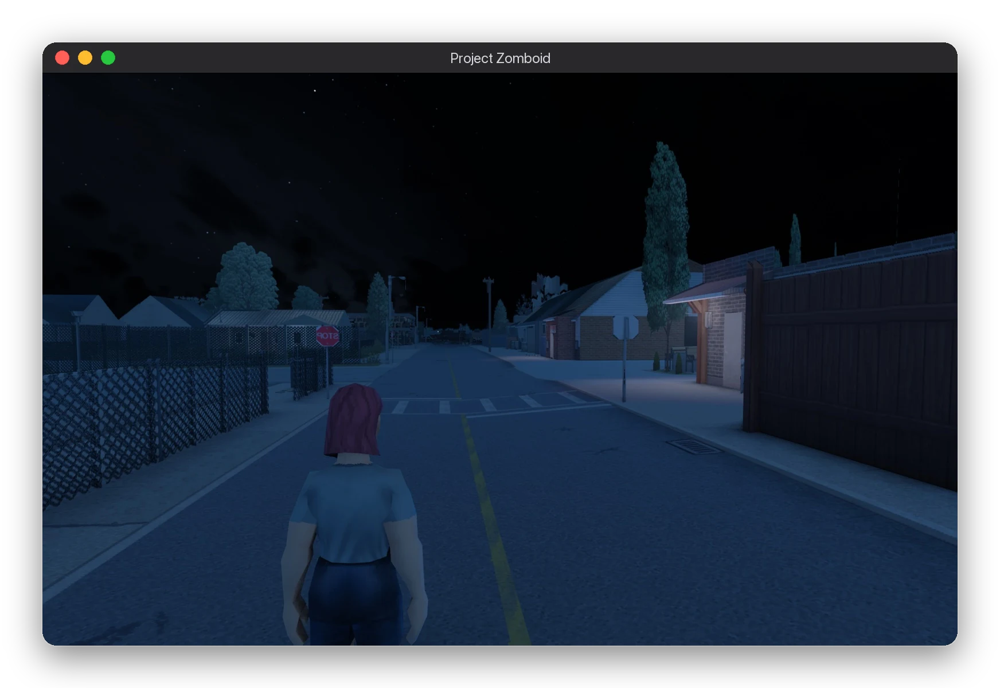

# Viewpoint for Mac


A ZombieBuddy mod that lets [Project Viewpoint](https://steamcommunity.com/sharedfiles/filedetails/?id=3809306528) run on macOS. Viewpoint is written for OpenGL 4.5, and on a Mac Project Zomboid only gets OpenGL 2.1, so this mod translates between the two while you play. On Windows and Linux it does nothing.

<p align="center">
  
</p>

<table>
  <tr>
    <td width="33%"></td>
    <td width="33%"></td>
    <td width="33%"></td>
  </tr>
</table>

<sub>An M5 Pro at 1920x1200, with Viewpoint's default pack at its default settings.</sub>

## What you need

- Project Zomboid build 42.21 on Steam.
- [ZombieBuddy](https://steamcommunity.com/sharedfiles/filedetails/?id=3619862853) and Project Viewpoint from the Workshop.
- JDK 21 or newer, to build the mod. The game runs it on its own Java.

## Install

```bash
git clone https://github.com/Harkor421/ViewpointMac.git
cd ViewpointMac
tools/build.sh --install
```

That puts the mod in `~/Zomboid/mods/ViewpointMac`. Then:

1. In Steam, set the game's launch options to `-javaagent:ZombieBuddy.jar --`.
2. In the game's Mods menu, enable ZombieBuddy, Viewpoint for Mac and Viewpoint.
3. When ZombieBuddy asks, tick Allow for Viewpoint for Mac and press OK. It asks again after every new build.

Keep Steam open while the game starts, or the game stops while booting.

## What to expect

On an M5 Pro at 1920x1200, Viewpoint runs at about 45 to 75 fps with the default pack, depending on the time of day, the weather and how much of the world is in view. Lowering Viewpoint's quality settings doesn't change that, because the limit is Apple's OpenGL driver on the CPU, not the GPU.

Workshop add-ons that require Viewpoint (True Weathers, Recoil & ADS, True Ballistics and the rest) are handled automatically.

Not available on the Mac:

- Viewpoint's ImGui settings window. Its shader asks for GLSL 1.30, which the Mac's OpenGL 2.1 refuses, so Viewpoint turns the window off.
- Minecraft-style shader packs (Iris). They need compute shaders, tessellation and other features OpenGL 2.1 doesn't have.
- Upscalers. DLSS, FSR and XeSS are Windows-only anyway.

## If something breaks

Open an [issue](https://github.com/Harkor421/ViewpointMac/issues) with `~/Zomboid/console.txt`. If a shader failed, the Mac's error and the shader are saved in `~/Zomboid/viewpointmac/failed-shaders/`; attach that folder too.

## For add-on authors

If your `mod.info` requires Viewpoint and has a `javaPkgName`, your add-on works on the Mac with no extra work. Write GLSL 3.30 and use as many texture units as you like. Compute shaders, image load/store, uniform and storage buffer blocks and tessellation aren't available.

## Building and testing

`tools/test.sh` runs every offline check (the smoke test, every shader pack, every installed add-on) and exits non-zero if anything fails. Run it before installing a build of your own.

## License

MIT, see [LICENSE](LICENSE). Project Viewpoint, ZombieBuddy and Project Zomboid belong to their own authors. This repository holds none of their code, only the shader constants Viewpoint generates (`tools/constants.glsl`, `tools/runtime-defines.glsl`), which the offline checks need.
