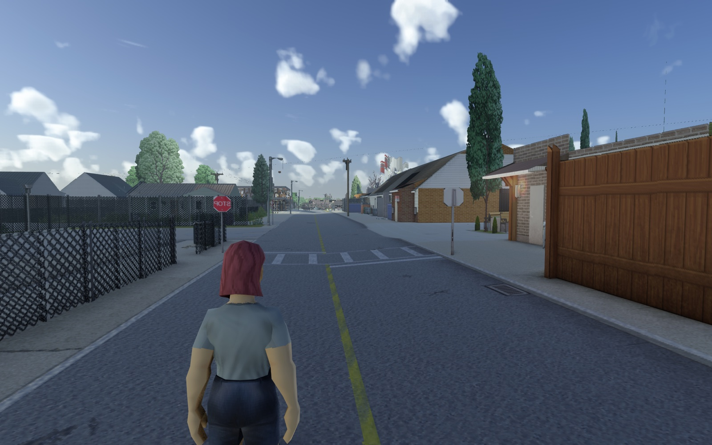
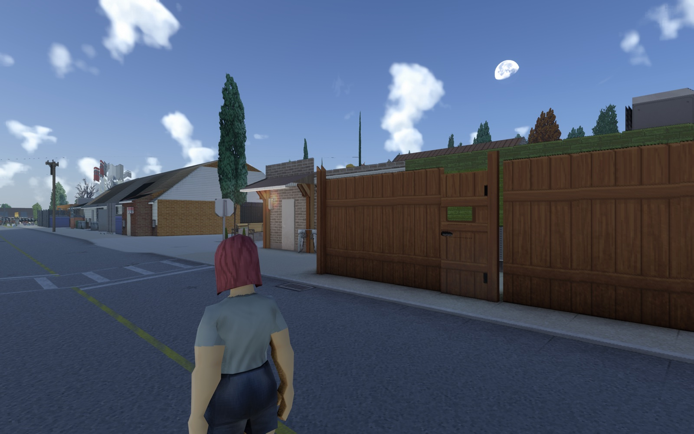
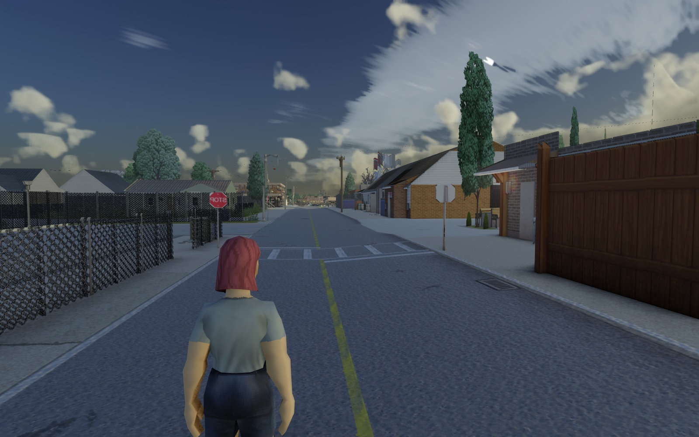
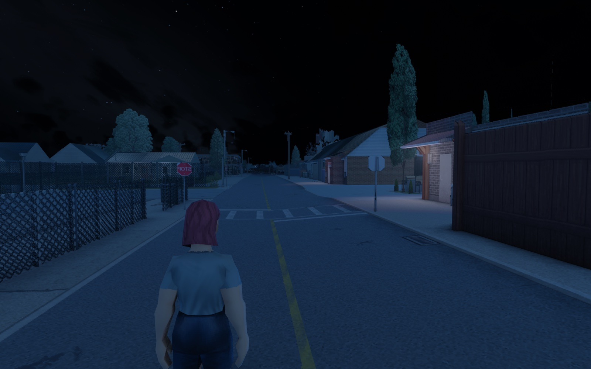

# Viewpoint for Mac


A ZombieBuddy Java mod that lets [Project Viewpoint](https://steamcommunity.com/sharedfiles/filedetails/?id=3809306528) run on macOS.

On a Mac, Project Zomboid gets a legacy OpenGL 2.1 context: 16 texture units and GLSL 1.20. Viewpoint is written for OpenGL 4.5, with GLSL 3.30, direct state access, texture and sampler objects, indirect draws and around 140 texture units. This mod translates between the two. On Windows and Linux it does nothing.

<p align="center">
  
</p>

<table>
  <tr>
    <td width="33%"></td>
    <td width="33%"></td>
    <td width="33%"></td>
  </tr>
</table>

<sub>An M5 Pro at 1920x1200, the default pack at its default settings. Each image is the frame Viewpoint composites, read inside the game by <code>tools/screenshot.sh</code>, so the game's interface isn't in it.</sub>

## How it works

### What gets rewritten as it loads

`Remap` rewrites Viewpoint's bytecode as the classes load. Any call into LWJGL's GL classes that `G` has a stand-in for, with the same name and descriptor, goes to `G` instead. The game's own GL calls stay as they are.

`Addons` does the same for every installed mod whose `mod.info` requires Viewpoint, using that mod's `javaPkgName`. It finds them at start-up, so add-ons that draw for Viewpoint get the same stand-ins and the same shader translation. Some add-ons reach LWJGL by reflection (`getDeclaredMethod` on `GL33`…), and `Reflect` hands those `G`'s methods instead.

`SlotPatch` limits Viewpoint's model batches (`ModelBatches.slot`) to as many textures as the model shaders keep. That number lives in `ModelSlots`. It starts at 8 and only drops when a model program can't fit the Mac's units any other way.

### Shaders

`Glsl` translates each shader when `glShaderSource` is called, targeting GLSL 1.20 with `EXT_gpu_shader4`, `EXT_texture_array`, `ARB_draw_instanced` and `ARB_shader_texture_lod`. `in` and `out` become `attribute` and `varying`, and `layout(location)` turns into bind calls made before linking. `texture()`, `texelFetch()` and the other texture functions become overloaded helpers, and so do `inverse()` and `determinant()`. A `samplerBuffer` becomes a 2D texture read row by row. Declarations end up one per line.

`Prog` links the program. When a program uses more than 16 texture units, its cheapest `sampler2D`s move into the `Atlas`: small tables first, then screen buffers, then depth, and the relief last (see `Glsl.cost`). The atlas is two sheets every program shares, one of half floats and one of full floats. Each texture has one place, in the sheet its format needs (depth, 32-bit floats and 16-bit normalized formats go in the full one), and is copied there once each time it changes, however many programs read it. A program reads both sheets, and each texture's uniforms say which one. Huge textures are stored at most 2048 a side, though the shader still sees their real size, and both sheets together stay under 768 MB; a sheet that fills up is packed again with what the last few seconds read. If nothing is left to move, the program first reads everything from the full sheet alone (one sampler instead of two), and only then, if it has the model texture array, keeps fewer model textures.

### State the 2.1 context lacks

The layer keeps this state in software and makes it real right before each draw.

- `G` and `Draw` handle virtual texture units, mapped onto the 16 real ones for each draw through a plan cached per program. Between them they also cover sampler objects (`Smp`), immutable storage and views (`Tex`), buffer textures and indirect commands (`Buf`, `Merged`), vertex array objects with separate formats (`Vao`), indirect multi-draws with base instance, per-buffer clears, image copies and range mapping.
- `NoAttribs` exists because legacy GL draws nothing unless attribute 0 is enabled, while Viewpoint's full-screen passes build their triangle from `gl_VertexID` alone. Those draws get a stand-in attribute 0.
- `OutsideBinds` catches model textures that Viewpoint binds with the game's own `Texture.bind()`, which bypasses `G`. A scratch real unit picks up those binds.
- `Readback` sends depth reads into a pixel-pack buffer through a GPU copy, so they don't stall. The performance notes below explain why that matters.
- `Timers` builds `glQueryCounter` timestamps from chained elapsed-time queries when asked to.

For diagnostics there are `Dump` (requests in `dump.txt`), `Stats` (counts and GPU reports, plus one automatic measurement per game), `Prof` (a stack sampler) and `HotReload` (for development).

## Status

The offline checks pass on an M5 Pro (`tools/test.sh`). The mod compiles and all 111 smoke checks pass. Every shader in Viewpoint's packs (Default, Library, Vivid and Vanilla) and in True Weathers' pack compiles and links, using the atlas where the game would; only Vivid's model glass keeps 7 model textures instead of 8. The 12 installed Workshop add-ons built on Viewpoint go through `Remap`, their shader files compile, and none of the GL calls they keep is missing on the Mac.

Measured in the game on an M5 Pro at 1920x1200 in October 2026, the isometric view runs at about 243 fps. Viewpoint runs at roughly 45 to 75 fps with the default pack at its default settings, depending on the time of day, the weather and how much of the world is in view. What holds it there is the render thread's CPU, inside Apple's OpenGL driver: each of Viewpoint's 5,000 or so draws a frame costs the driver 0.4 to 1.4 µs, and turning Viewpoint's quality options down doesn't change the frame rate. The performance notes below show how that was measured and what the layer does about it.

Workshop add-ons have only been checked offline so far. True Weathers, Immersive Physics & Weather, Recoil & ADS, Advanced Throwables and True Ballistics draw through the layer. Door, Surface, Near Vegetation, QOL, Isometric No More and Immersive Driving don't need anything from it.

An independent review on 2026-10-25 turned up these bugs. They are fixed now, and each one has a smoke check that fails without its fix.

- Per-draw data with a divisor of 2^30, which Viewpoint uses for its pack draws, always read the first draw's data, because the layer divided the base instance by the divisor.
- Reading a buffer the GPU had written into, as the lamp read-backs do, returned the stale CPU copy.
- Textures and buffers deleted and created again under the same name kept their old contents in the atlas and in buffer textures.
- A few state leaks: after a failed indirect draw, from GL errors on names only the layer knows, and from debug reads.

Still open: Merged's "buffers of different formats share a texture" warning.

The Mac can't run Minecraft-style shader packs (Iris), which need compute, tessellation, UBOs or image load/store. Upscalers aren't supported either, and DLSS, FSR and XeSS are Windows-only anyway.

## Install

You need Project Zomboid on Steam with ZombieBuddy, and JDK 21 or newer for `javac`. The game's own JRE runs the mod.

```bash
tools/build.sh --install            # → ~/Zomboid/mods/ViewpointMac
```

In the game, enable ZombieBuddy, Viewpoint for Mac and Viewpoint, then approve the ViewpointMac JAR when ZombieBuddy asks. It asks again after every new build. The launch option is `-javaagent:ZombieBuddy.jar --`. Keep Steam running, or the game stops while booting.

## For add-on authors

If your `mod.info` has `require=...,\Viewpoint` and a `javaPkgName`, your add-on works on the Mac with no extra work, because its classes get rewritten the same way Viewpoint's do. A package that draws for Viewpoint without requiring it can be listed in `~/Zomboid/viewpointmac/packages.txt`.

A few things help:

- Compile shaders and set uniforms either through Viewpoint (`GlProgram`, shader pack passes) or through LWJGL from your own package. Both reach the translator. Write GLSL 3.30.
- Use as many texture units as you like, since the Mac maps them onto its 16 real ones for each draw. `GL_MAX_COMBINED_TEXTURE_IMAGE_UNITS` returns 188, and the last few units belong to the layer.
- A program can sample more than 16 textures, because the extra `sampler2D`s move into an atlas. Integer, array, cube, 3D and shadow samplers can't move, so keep those few. A model program that still doesn't fit makes every model batch hold fewer textures.
- Compute shaders, image load/store, uniform and storage buffer blocks and tessellation aren't available on the Mac. Depth reads into a pixel-pack buffer are fine up to 64x64, and the layer makes them non-blocking.

## Development

Before installing a build, run every offline check:

```bash
tools/test.sh
```

The script compiles the mod and runs the smoke test. Then it compiles and links every shader pack with the defines the game would use, and runs each installed add-on and Viewpoint itself through `Remap`, checking the result against what the Mac's context really exports. Last, it reports the layer's cost per frame. It exits non-zero if anything fails.

Each tool it uses also works on its own:

| Tool | What it does |
|---|---|
| `tools/SmokeTest.java` | Drives the stand-ins the way Viewpoint does, in a hidden Mac context, and checks both the pixels and the bookkeeping. |
| `tools/check.sh` (`ShaderCheck`) | Translates, compiles and links a folder of shaders. Pass `-Ddefines=` and `-Dpacks=` for a pack's real defines, or `-Dverbose` to trace atlas packing. |
| `tools/RemapCheck.java` | Runs `Remap` over extracted classes. With `-Dcontext` it also checks that every GL call left for LWJGL exists on the Mac. |
| `tools/bench.sh` | Times a Viewpoint-shaped frame through the layer, on the CPU and until the GPU is done. Give it another build's classes to compare, or set `BENCH_OPTS=-Dprofile=S` to sample stacks. |
| `tools/probe.sh` | Measures the Mac's legacy context itself: its extensions and limits, and which reads and writes stall. |
| `tools/drawprobe.sh` | What one command of an indirect list costs the driver, issued each way the layer could issue it. `PROBE_OPTS="-Dheavy=1 -Dtimer=1"` adds Viewpoint's targets, textures and a running GPU timer. |
| `tools/contextprobe.sh` | Viewpoint's world pass in the game's legacy context, or in a 4.1 core one with `PROBE_OPTS=-Dcore=1`. |
| `tools/packplan.sh` | Plans atlas packing offline for given shader pairs. |
| `tools/screenshot.sh` | Saves Viewpoint's final image from the running game as a JPEG, without the game's interface and without capturing the screen. |

### With the game running

- `tools/game.sh start` launches the game with ZombieBuddy's local Lua server and loads a copy of a save (`Apocalypse/vpmac-test`, never the player's own) past "click to start". `tools/game.sh stop` quits and restores the player's Continue. In between you can use `view`, `lua`, `log`, `crash` and `shot`, which captures only the game's window.
- `tools/dev.sh` compiles into `build/dev-classes`, and the running game watches that folder. Changed method bodies and brand-new classes take effect in about a second.
- `tools/perfcheck.sh` measures a running game in one go: frame rate, `stats:`, `gpu:` and `profile:`.
- More requests for `dump.txt` when looking for what costs a frame: `census:S` counts buffer uploads, texture uploads and indirect commands by shape; `atlas:S` counts atlas copies by texture; `hunt:S` samples who hands the game's sprite renderer its work; `finalprog` logs which programs draw into the game's framebuffers, the once-a-frame one being Viewpoint's final composite; `cpu:S` logs the CPU time each thread really used, which tells a thread that works from one that waits inside the driver; `spin:N` adds N ns of busy work to every draw the layer starts (`spin:0` stops), and if the frame rate falls by what that adds up to, the render thread's CPU is the limit; `hold-writes:0` sends writes into Viewpoint's stream buffer to GL as they come instead of holding them until the GPU reads it, and `hold-writes:1` holds them again; `tex:ID` and `texa:ID` save a texture's colour or alpha as a PNG; `vp:key=value` sets one of Viewpoint's live settings for an experiment without saving it, and `vp?key` reads one. Touching `patch-game-draws` next to it routes the game's own sprite draws through `GameDraws`, which counts them every 5 s; then `gamedraws` logs one frame of them by program, texture and size, and `gamestate` logs the GL state the first of them meets after a Viewpoint frame.
- Lines written to `~/Zomboid/viewpointmac/dump.txt` ask for a look inside the next frames (see `Dump`). You can ask for a sampler's texture, `N:bindings`, `after:N` (what program N drew), `uniforms:N`, `set:N:uName=value`, `errors` or `screen`. PNGs go to `dumps/` and value ranges go to the log. `stats:S` logs what the layer did per second over S seconds. `gpu:S` logs Viewpoint's own GPU time per pass along with the layer's (atlas copies, buffer textures, texture views, depth reads). `profile:S` writes `profile.txt`. Requests nothing answers within 20 s are dropped, and `clear` drops them right away.
- Once per game, a minute after Viewpoint starts drawing for real, the layer measures itself for 20 s (frames per second and counts, then GPU passes) and writes the results to the log. A file named `no-auto-measure` next to `dump.txt` turns this off.
- Shaders the Mac refuses are saved with their logs under `~/Zomboid/viewpointmac/failed-shaders/`. Programs that use the atlas are saved under `packed-shaders/`, as the game built them.

## Performance notes

What the performance work has bought so far, measured in the game on an M5 Pro:

| Change | Before | After |
|---|---|---|
| ZombieBuddy's log overlay off in test launches | 38 fps | 70 fps |
| Depth under the cursor read through a GPU copy (`Readback`) | 34 ms stall | 0.1 ms |
| Atlas: one shared copy of each texture | 70.8 ms of GPU a second | 40.2 ms |
| Stream writes held until the GPU reads them (`StreamWrites`) | 45 ms of the render thread a second | 8 ms |
| World draws with one per-draw value as a constant (`PerDraw`) | 0.53 to 0.83 µs a command | 0.36 to 0.66 µs |
| The layer's CPU per frame in `tools/bench.sh` | 1.02 ms | 0.81 ms |

The findings behind them come from `tools/probe.sh`, `tools/drawprobe.sh`, `tools/contextprobe.sh` and `tools/bench.sh` on an M5 Pro (macOS 27, "2.1 Metal"), and from measuring the running game.

- A `glReadPixels` of `DEPTH_COMPONENT`/`FLOAT` into a pixel-pack buffer blocks the CPU until the GPU has finished everything queued, 34 ms behind 35 ms of work. Color reads into a pack buffer (`RED`/`RG`/`RGBA` as `FLOAT`) don't wait. Viewpoint reads the depth under the cursor every frame, so `Readback` copies that depth on the GPU into an R32F target and reads that instead. The bits come out identical and the read takes about 0.1 ms.
- `EXT_timer_query` works, but `ARB_timer_query` doesn't exist. `Timers` builds `glQueryCounter` timestamps from a chain of elapsed-time queries. Each switch costs about 35 µs of CPU, so the timers only run when asked for. Occlusion queries go straight to GL.
- The GPU handles plain fills quickly: 40 full-screen passes over 1920x1200 RGBA16F targets take 0.6 ms, which is also why atlas copies of screen buffers are cheap. Clearing a target before drawing over all of it is slower (2.7 ms), since the Mac's GL doesn't turn the clear into a load action.
- ZombieBuddy's experimental log overlay draws every recent log line letter by letter, each letter its own draw. With Viewpoint's slow-frame lines in the log that came to about 35,000 extra draws a frame and halved the frame rate (38 fps with it, 70 without). It only exists when ZombieBuddy runs with `experimental`, which the test launch needs for its Lua server, so `tools/game.sh` turns it off once the save is loaded. A normal launch from Steam doesn't have it.
- A `glBufferSubData` into a buffer the GPU still reads costs about 67 µs in the probe, against 3 to 5 µs once the buffer is marked not serialized (`APPLE_flush_buffer_range`). `Streams` marks the ring Viewpoint streams per-frame data into (`FrameStream`, the only writer through `GL_COPY_WRITE_BUFFER`), which only ever writes past what the GPU may still read. In the game the same writes still cost about 27 µs each, marked or not: about 1,700 a second, 45 ms of the render thread's every second. Since each write is already in the buffer's CPU copy, `StreamWrites` holds them and sends them, one call per run of them, only before something reads the buffer on the GPU. Buffer textures made from it used to be that reader, copying rows GPU-side from the buffer; they now copy from the CPU copy (`Tex.uploadRows`), which is also the cheaper upload (4.8 against 73 µs in the probe). What still reads the stream on the GPU is the model batches, whose three per-draw attributes stay instanced arrays: about 390 sends a second of 41 KB at 21 µs, 8 ms a second instead of 45.
- In the game the render thread is the limit, and most of its time is spent inside the driver. With `spin:4000` (3.5 ms more CPU a frame) the frame rate fell from 69 to 56 fps, the drop that CPU time predicts, while `cpu:S` shows the thread on the CPU 81% of the time. None of Viewpoint's quality options moves the frame rate on its own (clouds, volumetrics, ambient occlusion, a shadow cascade fewer, reflections a step down): what the frame pays for is the number of GL calls, not what they draw.
- A 4.1 core context costs the same per draw as the game's legacy one (`tools/contextprobe.sh`), so a renderer of its own for Viewpoint wouldn't buy anything. The Mac's multithreaded GL engine (`kCGLCEMPEngine`) does move the driver's work off the render thread, but every state query then waits for that thread to catch up. With the layer's queries answered from what it knows, the wait moved to the next query (Viewpoint's own, and its reads of GPU buffers), and the frame rate stayed where it was.
- Indirect draws can't be merged into fewer GL calls. Each command brings its own per-draw value (a section number with flags in its top byte, which changes from list to list), and 2.1 has no base instance, so every command is its own draw. What a command costs is mostly the state that changes before it: measured in the game, moving an instanced array and drawing costs 0.53 to 0.83 µs, setting the attribute's current value and drawing plainly 0.36 to 0.66 µs, and a draw with nothing changed 0.15 to 0.2 µs. `PerDraw` takes the constant path for lists with one per-draw attribute, about 280,000 commands a second. With three (a matrix) the constants cost more than the array, 1.6 against 1.4 µs, so those lists keep it.
- A `glGetIntegerv` costs about 0.35 µs and a draw with unchanged state about 0.1 µs. For each draw the layer sticks to a cached plan (`Draw.plan`), saves the array buffer once per vertex-array replay or indirect draw, and does nothing for `Dump` unless something was asked for. What remains in the bench is the GL calls themselves: the draws, and one binding query per borrowed unit. That query stays because the game's own code binds textures behind the layer's back.
- Over 2000 bench frames, repeated, the layer's CPU cost per frame went from 1.02 to 1.03 ms before the 2026-10-25 pass down to 0.81 to 0.83 ms after.
- The atlas copies each texture once per change into one sheet. In the game that is once a frame for the 14 textures programs pack, most of them screen buffers Viewpoint redraws every frame. Before a texture had one home, those a full-float-only program also read were copied into both sheets, and the atlas took 70.8 ms of GPU time a second; with one home it takes 40.2.

## License

MIT, see [LICENSE](LICENSE). Project Viewpoint, ZombieBuddy and Project Zomboid belong to their own authors. This repository holds none of their code, only the shader constants Viewpoint generates (`tools/constants.glsl`, `tools/runtime-defines.glsl`), which the offline checks need.
